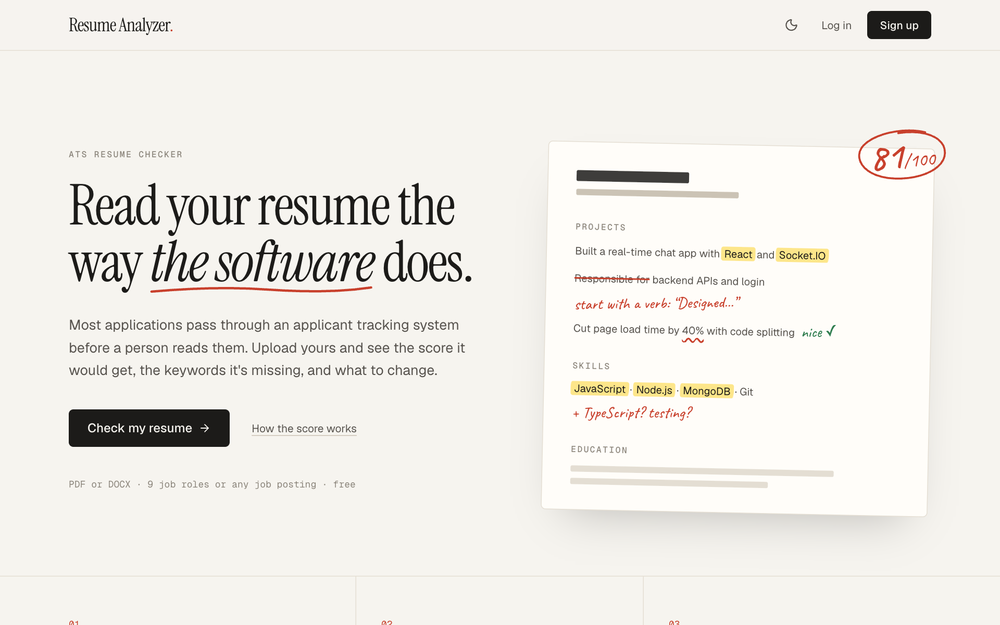
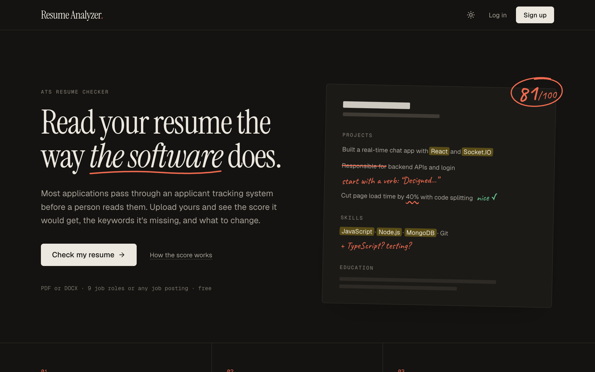
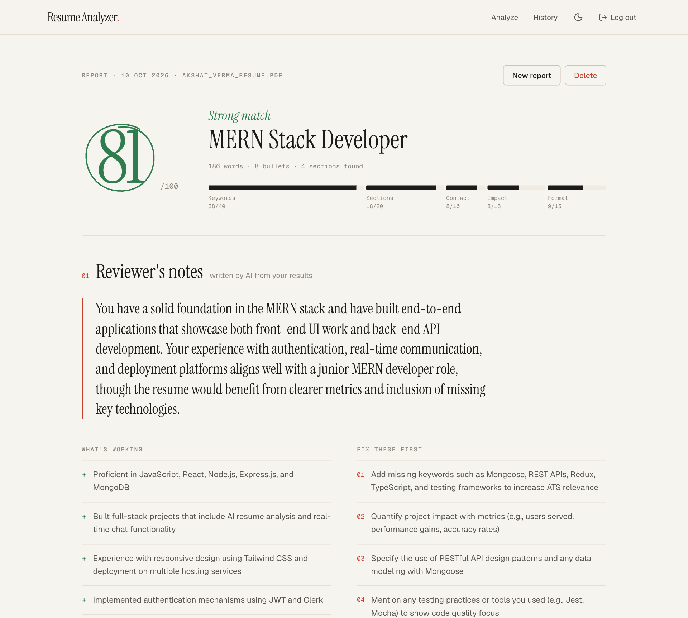
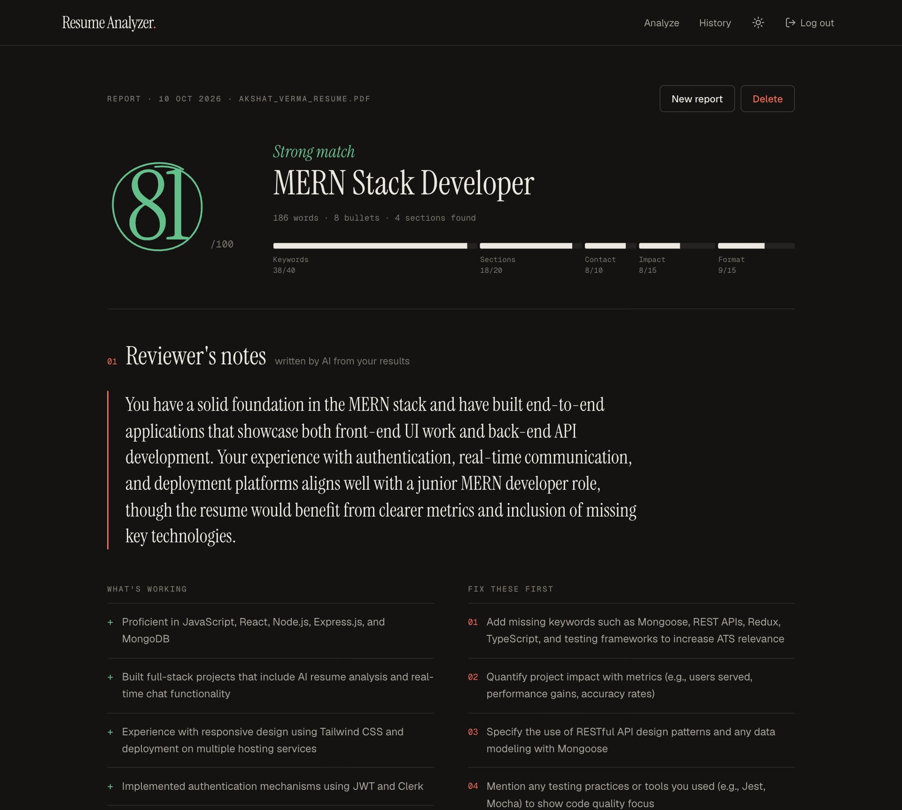
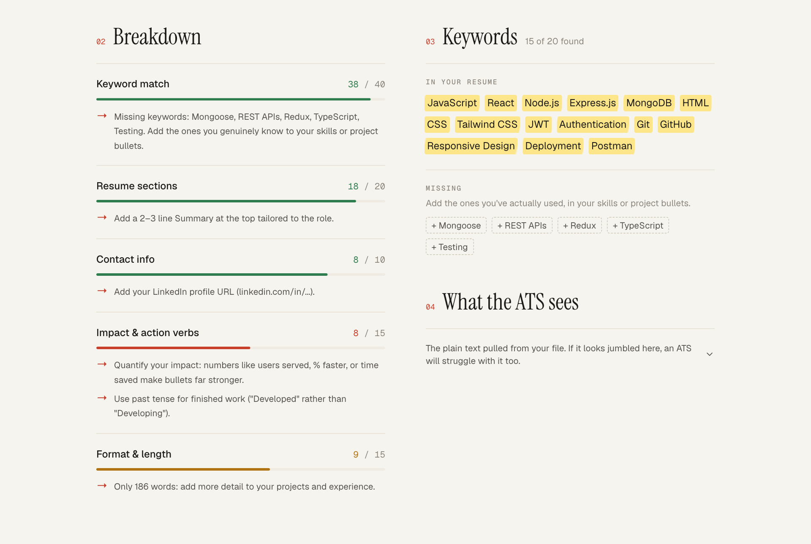
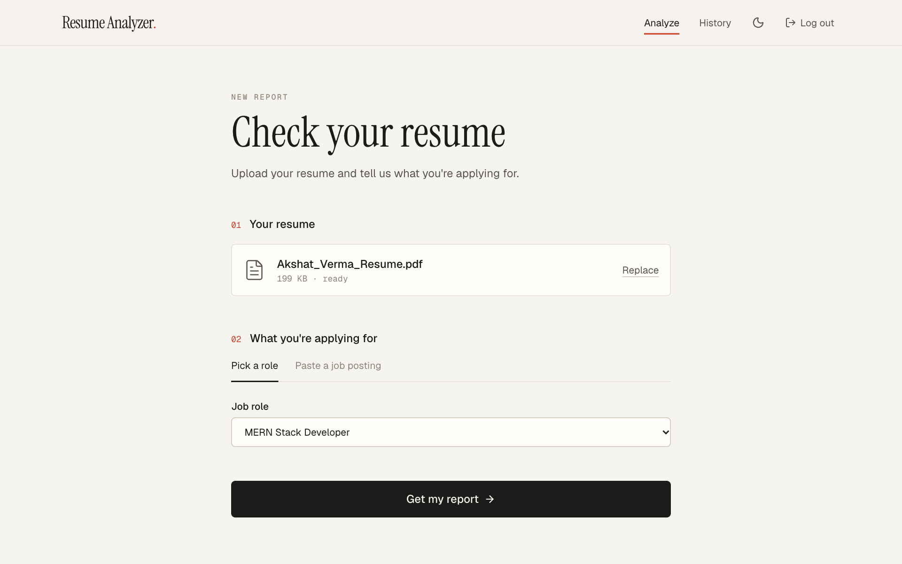
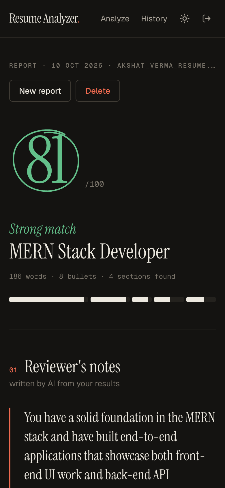
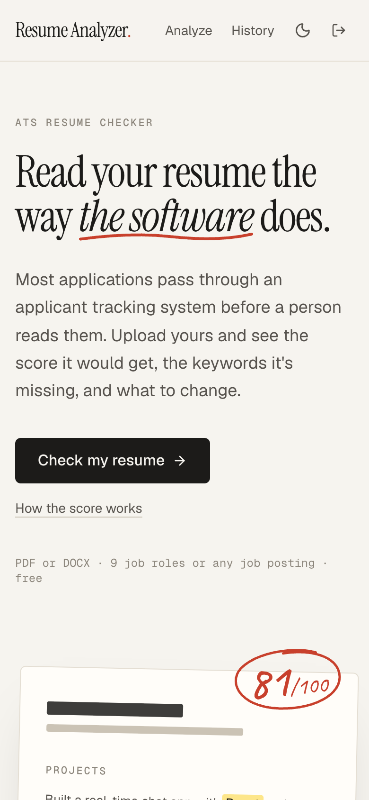

# AI Resume Analyzer

A full-stack MERN app that reads a resume the way an applicant tracking system (ATS) does. Upload a PDF or DOCX, choose a job role or paste a real job posting, and get a score you can trace line by line, the keywords you're missing, and reviewer-style notes on what to fix first.

<!-- Live demo: add your Vercel link here once deployed -->

<p align="center">
  
  
</p>

## Features

- **ATS score out of 100**, split into five categories so every lost point has a reason and a fix
- **Keyword matching** against 9 preset roles or any pasted job description, with synonyms ("node" counts as Node.js)
- **Reviewer's notes** written by AI: a summary, what's working, what to fix first, and rewrites of your weakest bullet points with blanks for your real numbers
- **What the ATS sees**: the raw text pulled from your file, so you can spot layouts that confuse parsers
- **Saved history** of every report, private to your account
- **Light and dark mode** that follows your device, or your own choice from the navbar or footer
- **Works on phones**, from the upload form to the full report

## Screenshots

**The report** (light and dark)

<p align="center">
  
  
</p>

**Score breakdown and keywords**

<p align="center">
  
</p>

**Upload form and mobile**

<p align="center">
  
  
  
</p>

## How the score works

The score is calculated by **rule-based code, not by the AI**. The same resume always gets the same score, and every point can be explained.

| Category | Points | What's checked |
|---|---|---|
| Keyword match | 40 | Share of the target's skills found in the resume. 80% coverage earns full marks, since no one matches every keyword |
| Sections | 20 | Education, Skills, Experience or Projects, Summary, Certifications |
| Impact | 15 | Bullets that start with an action verb ("Built", "Reduced") and include a number |
| Format & length | 15 | Word count, real bullet points, no first-person pronouns, no weak phrases like "responsible for" |
| Contact info | 10 | Email, phone, LinkedIn, GitHub |

The AI is given the score and keyword results and only writes the notes. It is instructed not to invent experience or numbers, to use blanks like `[X%]` where a metric is needed, and to judge the resume at the level it shows (student, fresher, experienced). If the AI service is down, the report is still saved with the full score.

## What happens when you upload

1. **Multer** receives the file in memory (5 MB limit). Nothing is written to disk.
2. **`parser.js`** checks the file's first bytes to confirm it's really a PDF or DOCX, extracts the text with `pdf-parse` or `mammoth`, and cleans it up.
3. It finds section headings, contact details and bullet points.
4. **`keywords.js`** picks the target: a preset role's keyword list, or the skills found in a pasted job description (at least 3 are needed). It matches 69 skills across 163 spellings.
5. **`scorer.js`** scores the five categories and writes a tip for each missed point.
6. **`ai.js`** sends the resume and results to Groq and receives JSON validated against a schema.
7. The report is saved to MongoDB and returned to the browser.

## Tech stack

| Layer | Tools |
|---|---|
| Frontend | React 19, Vite, Tailwind CSS v4, React Router, Axios, Lucide icons |
| Backend | Node.js, Express 5 |
| Database | MongoDB Atlas, Mongoose |
| Auth | JWT, bcrypt |
| Resume parsing | `pdf-parse`, `mammoth`, Multer |
| AI | Groq API (free tier), `openai/gpt-oss-120b` with JSON-schema structured output |
| Security | Helmet, CORS, `express-rate-limit` |
| Hosting | Vercel (frontend), Render (backend) |

## Design

The interface is styled like a resume on a reviewer's desk instead of a typical SaaS dashboard: warm paper and ink colours, with marks a person would make on a printout. Matched keywords get a highlighter stroke, rewritten lines are struck through in red, and the score is circled by hand (an SVG path).

- **Type:** Instrument Serif for headings, Geist for body text, Geist Mono for labels and numbers, Caveat for handwritten notes
- **Theming:** every colour is a CSS variable in `client/src/index.css`, defined once for light and once for dark, and exposed to Tailwind as `bg-paper`, `text-ink`, `border-line` and so on. Components never hard-code colours, so both themes stay in sync.
- **No flash on load:** a small inline script in `index.html` applies the saved theme before the page paints. The choice (System, Light or Dark) is stored in `localStorage`.

## Project structure

```
├── client/                    React frontend
│   ├── src/
│   │   ├── pages/             Landing, Auth, Analyze, Result, History
│   │   ├── components/        Navbar, Footer, UploadBox, AIFeedback, Breakdown, Keywords,
│   │   │                      MarkedUpResume, Marks (hand-drawn SVGs), ThemeToggle
│   │   ├── context/           AuthProvider (JWT session), ThemeProvider (light/dark/system)
│   │   ├── api/client.js      Axios instance that attaches the token
│   │   ├── utils/score.js     Score colours and category weights
│   │   └── index.css          Colour tokens for both themes, shared component classes
│   └── vercel.json            Sends every route to index.html on Vercel
├── server/                    Express API
│   └── src/
│       ├── services/          parser.js, keywords.js, scorer.js, ai.js
│       ├── data/              skills.js (skills and synonyms), roles.js (preset job roles)
│       ├── models/            User, Analysis
│       ├── middleware/        auth (JWT), upload (Multer), errorHandler
│       ├── controllers/
│       ├── routes/
│       └── config/            environment check, MongoDB connection
└── docs/screenshots/
```

## API

| Method | Route | Auth | Description |
|---|---|---|---|
| POST | `/api/auth/register` | | Create an account, returns a JWT |
| POST | `/api/auth/login` | | Log in, returns a JWT |
| GET | `/api/auth/me` | ✓ | Current user |
| GET | `/api/roles` | | Preset job roles |
| POST | `/api/analyze` | ✓ | Multipart form: `resume` file plus `roleId` or `jobDescription` |
| GET | `/api/analyses` | ✓ | Your past reports |
| GET | `/api/analyses/:id` | ✓ | One report |
| DELETE | `/api/analyses/:id` | ✓ | Delete a report |

## Running locally

You need Node.js 20 or newer, a free [MongoDB Atlas](https://www.mongodb.com/atlas) cluster, and a free [Groq API key](https://console.groq.com/keys).

```bash
git clone https://github.com/Akshatt752/AI-resume-analyzer.git
cd AI-resume-analyzer

# Backend
cd server
cp .env.example .env      # then fill in the values below
npm install
npm run dev               # http://localhost:8000

# Frontend, in a second terminal
cd client
npm install
npm run dev               # http://localhost:5173
```

In development, Vite forwards `/api` requests to the backend, so no CORS setup is needed.

### Environment variables

**`server/.env`**

| Variable | Required | Description |
|---|---|---|
| `MONGO_URI` | Yes | MongoDB Atlas connection string |
| `JWT_SECRET` | Yes | Long random string used to sign login tokens. Generate one with `node -e "console.log(require('crypto').randomBytes(48).toString('hex'))"` |
| `GROQ_API_KEY` | No | Without it, reports include the score but no reviewer's notes |
| `GROQ_MODEL` | No | Defaults to `openai/gpt-oss-120b` |
| `CLIENT_URL` | No | Frontend URL allowed by CORS (comma-separate several). Defaults to `http://localhost:5173` |
| `PORT` | No | Defaults to `8000` |

**`client/.env`** (production only)

| Variable | Description |
|---|---|
| `VITE_API_URL` | Your deployed backend URL ending in `/api` |

## Deployment

**Backend on Render** (Web Service)
- Root directory `server`, build command `npm install`, start command `npm start`
- Add the `server/.env` variables in Render's dashboard, with `CLIENT_URL` set to your Vercel URL
- In MongoDB Atlas → Network Access, allow `0.0.0.0/0`, because Render's free tier has no fixed IP address

**Frontend on Vercel**
- Root directory `client`, framework preset Vite
- Set `VITE_API_URL=https://<your-render-app>.onrender.com/api`
- `client/vercel.json` already handles routing, so refreshing a page like `/history` works

## Security

- Passwords are hashed with bcrypt, and login tokens expire after 7 days
- Login and sign-up are rate-limited, and each user can run 15 analyses per 15 minutes, which keeps usage inside Groq's free tier
- Request fields must be plain strings, which blocks MongoDB operator injection such as `{"$gt": ""}`
- Uploads are checked by their file signature, not only the extension, and are never stored
- Every report query is scoped to the logged-in user, so nobody can open someone else's report by guessing its ID
- Helmet sets secure HTTP headers, and CORS only allows the frontend's URL
- Secrets live in `.env` files, which are git-ignored

## Roadmap

- Compare one resume against several job postings side by side
- Export the report as a PDF
- Chart your score across versions of your resume
- Unit tests for the parser and scorer

## Author

**Akshat Verma** · [GitHub @Akshatt752](https://github.com/Akshatt752)
